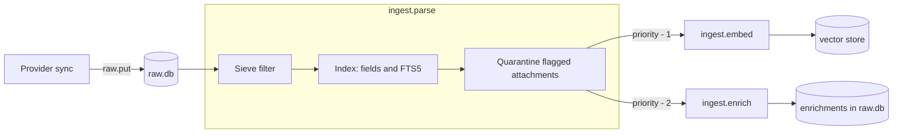

+++
title = "The ingest pipeline"
subtitle = "From a message on the server to a message you can search, ask about and enrich"
lead = "Mail is stored first, filtered and indexed second, and only then embedded and enriched. Every step can be repeated safely, so a crash, a model outage or a power cut costs time and never mail."
badges = [["text-bg-warning", "Pre-alpha"]]
group = "concepts"
order = 37
description = "The stages mail passes through (store, filter and index, embed, enrich), how each is made idempotent, what happens when a model is down, how tokens are counted, and the quarantine folder."
+++

## The stages

1. **Store.** The sync runner writes the exact bytes to `raw.db` and queues a parse job. The cursor
   is saved only after the whole batch is stored, so a crash re-pulls the batch and the second
   write changes nothing.
2. **Parse** (`ingest.parse`). The user's Sieve scripts run **first**, so a message that is
   discarded or marked `skip_enrich` never reaches the expensive stages. Then the message is
   indexed (fields and FTS5), flagged attachments are written to the quarantine folder, and the
   embed and enrich jobs are queued. From here on the message is **searchable by keyword**.
3. **Embed** (`ingest.embed`). Chunk text goes to the embedder and the vectors to the vector store.
4. **Enrich** (`ingest.enrich`). Each enricher runs on the cleaned text, and on the message's
   headers and attachment metadata. The first-party ones are `summary`, `triage`, `actions` and
   `inspector` (see below).

Embedding and enrichment are separate jobs because they are slow, can fail for different reasons,
and can be switched off on their own. With no embedder configured the pipeline is just store, filter
and index, and everything keyword-related works.

## Priorities and backlogs

A job's priority is that of the parse job minus 1 (embed) or minus 2 (enrich). New mail is
priority 50 and a backfill is 10, so a backlog of parsing always runs ahead of a backlog of
embedding, and new mail overtakes a backfill at every stage. Concurrency per stage is set with
`ingest.embed_concurrency` and `ingest.enrich_concurrency` (default 1: one local GPU).

**Backpressure.** A first sync of a large mailbox is a *backfill*. When the queued and running
`ingest.*` jobs reach `ingest.backfill_queue_cap` (default 2000), the backfill pauses, keeping its
cursor, and picks up on the next sync. The paused state is saved (`mail.backfill`), so a paused
backfill stays a backfill. New mail is never held back.

## Idempotent by content

Every stage is skipped when its input has not changed.

| Stage | Skipped when |
| --- | --- |
| Store | the message with this provider id already exists with the same bytes |
| Parse | the content hash and the pipeline version match what is indexed |
| Embed | the store already holds a vector for this chunk's `content_hash` under this model |
| Enrich | a result exists for `(content hash, enricher, enricher version, model)`; one produced for *another message with identical content* is copied |

So running the same sync again, or `reprocess`, makes no model calls and costs no tokens.

## When something is down

A stage job that fails is retried with exponential backoff (`jobs.backoff_base_seconds`, doubling,
with jitter) for `ingest.stage_max_attempts` attempts (default 8). A job whose worker died is
reclaimed when its lease (120 s by default) runs out. After the last attempt the job is **parked**:
it stays in the queue as failed and shows in `pipeline_status().parked` with the reason, so one
poison message never blocks the rest. Keyword search works throughout, because indexing never waits
for a model.

If the embedder's model differs from the one the store holds, embed jobs report `stale` and do
nothing, rather than mixing models. Run `reprocess("embed")` to switch (see below).

## Reprocessing

`Pipeline.reprocess(stage)` re-runs one stage over everything, as one low-priority job per stage
and account (asking twice queues once):

| Stage | What it does |
| --- | --- |
| `parse` | queues `index.rebuild` |
| `filter` | re-runs Sieve over messages whose scripts changed |
| `embed` | builds the new model's vectors beside the old ones, then activates it, then drops the old. The old vectors are never removed first, so search keeps working throughout |
| `enrich` | re-runs enrichers whose version, model or input changed; the rest are cache hits |

## Token accounting

Every call a stage makes, or avoids, is recorded in `ai_usage`: stage, model, tokens in and out,
and whether it was a cache hit. `usage_summary(since)` adds them up per stage and model and
reports **tokens saved**: what the cached calls would have cost. Embedding tokens are counted
from the text sent. The `enrich` rows are estimates from the tokenizer; each model call an enricher
makes is also recorded exactly under its own stage (`llm.enrich.summary`, ...) by `generate_cached`.

Enrichment results live in `raw.db`, not `index.db`, because they cost model time and `index.db`
can be thrown away and rebuilt.

## The enrichers

Each result is small structured data, stored once and reused, so a later question never re-reads
the body. A result is replaced only after its successor exists, and a version bump of one enricher
refreshes only that enricher's rows.

| Enricher | Model | Stores |
| --- | --- | --- |
| `summary` | yes | One to three sentences and up to five key points. A reply is summarized from its own new text plus the stored summary of the message before it, never that message's body. |
| `triage` | only if headers cannot say | `category`, `priority` 0-3, `needs_reply`, `waiting_on_others`, a short `reason`, and `source` (`rules` or `llm`). `Auto-Submitted`, `Precedence: bulk`, `List-Id`, `List-Unsubscribe` and a no-reply sender decide the category with no model call. |
| `actions` | yes | Action items and deadlines, each with a quote and where it sits. A quote that is not in the message is dropped and counted in `dropped`, so an invented task is never stored. |
| `inspector` | never | SPF, DKIM and DMARC from the topmost `Authentication-Results`, ARC, spam headers, hop count from `Received` headers, date sanity, `Reply-To` against `From`, `List-*` headers, and risky attachment names. Findings are short codes in `warnings`. |

The model-backed ones cut a long message to `ai.enrich_max_input_tokens` by keeping its head and
tail with a marker between, and say `truncated`. `summary` and `actions` do not ask a model about
bulk or automated mail (`skip_bulk`, on by default): nobody wrote it to the reader, and it is the
largest saving there is. Every model call goes through `generate_cached`, so mail is only ever
fenced `UntrustedText`, answers are validated against a schema, and a rerun is a cache hit.
Enrichment never marks a message read.

To check a model against the enrichers' fixtures by hand (not in CI):
`uv run python -m oaken.evals enrich [--enricher NAME]`. It scores properties of the result, not
exact words.

## The quarantine folder

Attachments flagged by name or type (executables, scripts, archives that hide them) are written to
`quarantine/` inside the data folder by the parse stage:

- The folder is mode 0700 and the files 0600, with no execute bit, named
  `<part>_<safe-name>.quarantined` so the name cannot escape the folder or mean anything to a shell.
- Core **only writes** there. It never opens, parses, analyses or runs what it wrote.
- Writing is atomic (a temporary `.part` file, then a rename) and idempotent.
- An attachment over `mail.attachments.quarantine_max_bytes` (50 MiB) is left in the message, which
  `raw.db` keeps whole.
- Turn it off with `mail.attachments.quarantine = false`. Unflagged attachments are never
  extracted.

`Quarantine.problems()` reports loose permissions from file modes alone.

## Plugins and events

Each step publishes an event (`MessageIndexed`, `MessageEmbedded`, `MessageEnriched`,
`AttachmentQuarantined`, `SyncStarted`, `SyncProgress`, `SyncFinished`). A plugin can listen with
`ctx.subscribe(EventType, handler)`; see [Plugins](../plugins.html). Handlers are read-only, and a
handler that raises cannot disturb the pipeline.

The pipeline reaches a vector store only through one small seam (`Vectors`), so more than one
store can sit behind it later.

## Settings

| Setting | Default | Meaning |
| --- | --- | --- |
| `ai.embedder` | empty | Embedder plugin to use; empty turns embedding off |
| `ingest.embed_batch` | 32 | Chunks per embedder call |
| `ingest.backfill_queue_cap` | 2000 | Queued `ingest.*` jobs at which a backfill pauses |
| `ingest.stage_max_attempts` | 8 | Attempts before a stage job is parked |
| `ingest.embed_concurrency` / `enrich_concurrency` | 1 | Jobs of each stage at once |
| `ai.enrich_max_input_tokens` | 3000 | Most tokens of one message an LLM enricher is sent |
| `plugins.<enricher>.enabled` | true | `false` skips that enricher |
| `plugins.summary.skip_bulk` / `plugins.actions.skip_bulk` | true | Do not ask a model about bulk mail |
| `ingest.throughput_window_seconds` | 600 | Window for the embedding speed shown in status |
| `mail.attachments.quarantine` | true | Write flagged attachments to the quarantine folder |
| `mail.attachments.quarantine_dir` | `quarantine` | Folder, relative to the data folder |
| `mail.attachments.quarantine_max_bytes` | 50 MiB | Largest attachment to write |
