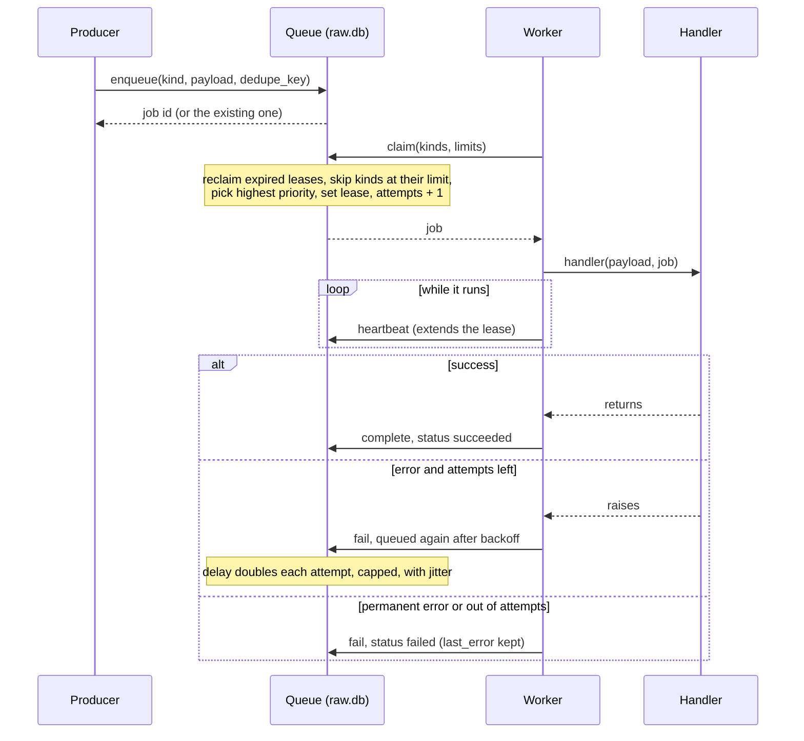

+++
title = "Events, jobs and the scheduler"
subtitle = "How core does work in the background"
lead = "An in-memory event bus tells the rest of core what happened. A durable job queue does the work, and survives a crash. A scheduler puts recurring work on that queue."
badges = [["text-bg-warning", "Pre-alpha"]]
group = "concepts"
order = 20
description = "The event bus, the durable job queue with leases and retries, and the scheduler."
+++

## The three pieces

| Piece | Lives in | Survives a restart? | Job |
|---|---|---|---|
| Event bus | memory | no | tell listeners that something happened |
| Job queue | `raw.db` | yes | run work at least once, with retries |
| Scheduler | `raw.db` | yes | enqueue recurring work on time, once |

Nothing here calls a model or a mail provider. Ingest, sync and enrichment arrive in later
prompts as job handlers; this layer only runs them.

## The job lifecycle

A job is a row in `raw.db`. Workers take jobs by *claiming* them: one short transaction marks
the best runnable job as `running` and gives the worker a **lease**. A worker that dies simply
stops renewing its lease; once the lease expires, the job is queued again.

States are `queued`, `running`, `succeeded`, `failed` and `cancelled`. Every change is also
published as a `JobStateChanged` event.

## Guarantees and rules

- **At least once.** If a worker dies mid-job, the job runs again after its lease expires, so
  handlers must be idempotent. A worker that lost its lease cannot mark the job done: the
  finish is fenced by the worker's id.
- **Dedupe.** An `enqueue` with a `dedupe_key` that is already queued or running does nothing
  and returns the existing job. Once the job finishes the key is free again.
- **Priority.** Higher runs first: user-initiated (100), ingest (50), backfill (10). Within a
  priority, the job that became runnable first goes first.
- **Retries.** After the Nth failed attempt a job waits `min(backoff_max, backoff_base * 2^(N-1))`
  seconds, shortened by up to `backoff_jitter` at random. After `max_attempts` it is `failed`.
  A handler can raise `PermanentJobError` to fail at once, and a payload that does not validate
  fails at once too.
- **Errors are stored safely.** `last_error` has secrets redacted and is cut to 500 characters.
- **Per-kind concurrency.** A kind can be capped, for example one `embed` job at a time for a
  single local GPU. Handlers declare a default; `[jobs] kind_limits` in `config.toml` wins.
  The cap is enforced in the claim itself, so it holds across all workers.
- **Cancellation.** A queued job is cancelled immediately. A running job is interrupted (its
  handler task is cancelled), so handlers should be cancel-safe.
- **Shutdown.** `stop()` lets in-flight jobs finish for a grace period, then cancels them and
  releases their leases without counting the attempt.
- **Long jobs.** A running job renews its lease every third of the lease length, so a slow local
  model can take as long as it needs.

## Events

The bus carries typed, frozen events: sync progress, message stored, parsed, indexed, embedded,
enriched, read-state changes, job state changes and plugin health. There are two kinds of
listener:

- **Handlers** are internal components. Every matching event reaches every handler, none is
  ever dropped, and a handler that raises is logged and skipped without affecting anyone else.
- **Streams** feed clients (the server-sent events endpoint later). Each has a bounded queue
  and, if a consumer falls behind, the **oldest** events are dropped and counted. A slow stream
  never blocks the publisher.

## Results, parents and actors

A job can store a **result**, which is checked against a schema for its kind before it is
saved. It can name a **parent** job, for splitting work into pieces, and it records its **actor**
(user, agent or system). Besides core's own workers, external agents can lease jobs too: see
[the swarm](swarm.html).

## The scheduler

A schedule is either a fixed interval or a five-field cron expression, evaluated in UTC (no
daylight-saving surprises). Its `next_run` is stored in `raw.db`. A tick enqueues the due jobs
and advances `next_run` in one transaction, so a restart neither repeats a run nor skips one.
If the process was down for several periods, the missed runs collapse into a single run.

The cron parser is about a hundred lines with no dependency. It covers `*`, lists, ranges, steps
and month and weekday names, which is everything "sync every five minutes" or "nightly backfill"
needs; a full library would add a dependency and time-zone handling that nothing here uses.

## Pausing the model

Two ingest stages call a model: `ingest.embed` and `ingest.enrich`. A person who wants to stop the
machine learning from working the queue — to free the GPU, or while on battery — pauses them with
`oaken pipeline pause` (and `resume`), or the `pause_backfill`/`resume_backfill` operations. Mail
keeps landing and being parsed and filtered (`ingest.parse` is CPU-only); only the model-bound
stages stop being claimed.

The switch is one durable row in `raw.db` (`pipeline_control`, migration 0013), so it survives a
restart: the runner holds a `paused_kinds` callback that reads it, and withholds those kinds from
each claim while paused. The low-level `JobQueue.claim` stays a primitive and is unaware of the
pause — the **runner** is the gate — and every change is audited. `pipeline_status` reports
`llm_paused`.

## Testing

Everything above is tested with a fake clock and no sleeping: advance the clock, call `drain()`
on the runner or `tick()` on the scheduler, and look at the database. The tests live in
`src/oaken/core/tests/`.
