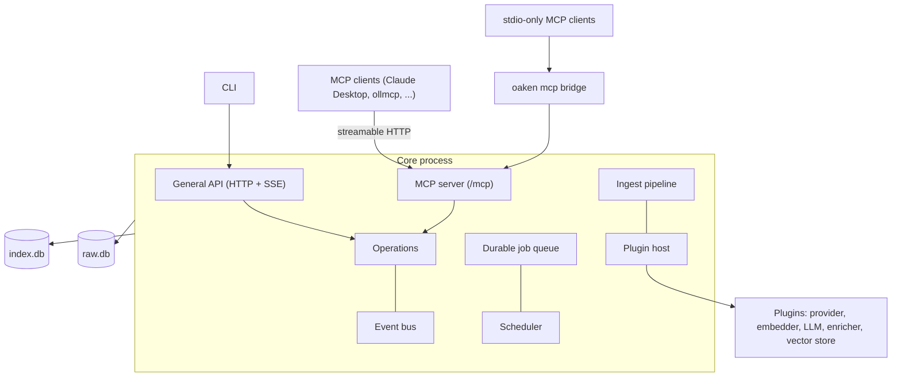

+++
title = "Architecture overview"
subtitle = "How Oaken Mail fits together"
lead = "One long-running core process owns your mail and its processing. Everything you interact with is a thin client of it, and everything it can be extended with is a plugin."
badges = [["text-bg-warning", "Pre-alpha"]]
group = "concepts"
order = 10
description = "The core process, thin clients, plugins and the two databases."
+++

## The shape of the system

A single core process does the work, and it offers two local surfaces over the same
operations. The **MCP server** is the heart of the product: a local, data-only MCP server for
sensitive mail, so a stronger model can search, read and act on your mail through a narrow,
audited interface while the mail itself stays on your machine. The **general API** serves the
command line and the web interface. Both are bound to `127.0.0.1` and protected by tokens, and
the MCP server runs whether or not the web interface does. See
[ADR 0004](repo:docs/adr/0004-mcp-server-in-core.md).

Because clients hold no logic of their own, they stay small, and the whole system can run
in a single process with fakes for tests.

## Two databases

Storage is two SQLite files, and only one of them is precious.

| File | Role | Contents |
|---|---|---|
| `raw.db` | Source of truth | Compressed original messages, provider ids, sync cursors, the job queue, the audit log |
| `index.db` | Derived and disposable | Parsed fields, cleaned text, chunks, full-text index, vectors, summaries and other enrichments |

`index.db` can be deleted and rebuilt from `raw.db` at any time. Changing the embedding
model therefore means running a job again, never downloading your mail again.

## Ingest

When a message arrives it moves through a staged, resumable pipeline. It is searchable by
keyword straight away; embedding and enrichment follow in the background. There is no
separate "analyze the mailbox" step after a sync.

## Plugins

Plugins extend the core through declared capabilities. In the first version they run
in-process and are first-party only.

| Plugin type | Job | First implementation |
|---|---|---|
| Provider | Authenticate, pull mail, write flags back | Gmail |
| Embedder | Turn text into vectors | Ollama |
| LLM backend | Run local language models | Ollama |
| Enricher | Derive summaries, triage, actions, header inspection | Built in |
| Vector store | Store and search vectors | sqlite-vec |

Plugins are optional-base-class subclasses (or any object with the right members) registered as Python entry points; see [Writing a plugin](../plugins.md).
The core never imports provider code, and a provider plugin never touches the databases.
They meet only through the contract: return values and events.

## Principles

- **Local first.** Nothing leaves the machine unless you configure a remote endpoint.
- **Mail is data.** Message text reaches a model only as clearly marked untrusted input,
  and actions that change mail are confirmed in code, not in a prompt.
- **Read state follows you.** A message is marked read only when you open or summarize it,
  never by background work.
- **No sending over MCP.** Sending mail is never exposed through the MCP server.
