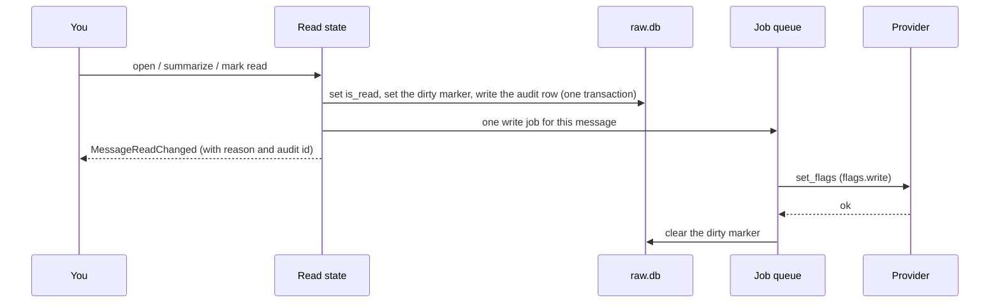

+++
title = "Read state"
subtitle = "A message is read because you saw it, never because software touched it"
lead = "One place in core marks mail read or unread. It happens when you open a message or ask for a summary of it, and for nothing else. Every change is local first, written to your mail service afterwards, recorded, and can be undone."
badges = [["text-bg-warning", "Pre-alpha"]]
group = "concepts"
order = 39
description = "What marks a message read and what never does, the local-first write-back state machine, the audit log and undo, the confirm gate, and the settings."
+++

## What marks a message read, and what never does

**These mark a message read:**

- You **open** it and it stays open for a moment (2 seconds unless you change it). If you move on
  before then, nothing happens.
- You **ask for a summary** of it, in the app or through an MCP client (`summarize_email`).
- You mark it read yourself.

**These never do, and a test makes sure it stays that way:**

- Syncing, ingesting, parsing, filtering with Sieve, embedding or enriching mail. That includes a
  summary that was made in the background.
- Search results, list views and bulk reads.
- A Sieve script that sets `\Seen`. That is *your own organization of the message*, kept locally; it
  is not you having seen it.

Background work cannot do it even by mistake: a request from the system itself is refused
outright, whatever its reason and even with a confirmation.

## Local first

Marking a message read changes your local copy **at once**, so the screen is never waiting on
a mail server. Writing it back to the service follows, and a failure never undoes what you see.

### The state machine

The **dirty marker** (`message_state.local_dirty_json`) is what the server has not been told yet.

| Local state | Dirty marker | Something happens | What core does |
|---|---|---|---|
| unread | none | you read it | set read, set the marker, audit, queue a write |
| read | none | you read it again | nothing: no audit row, no write |
| read | `read` | you mark it unread | set unread, replace the marker (the one write job picks up the latest), audit |
| any | `read` or `unread`, provider can write | the write job runs and the provider accepts | clear the marker |
| any | marker | the provider is down or slow | keep the marker, retry with backoff; you keep seeing the local state |
| any | marker | the provider refuses for good | keep the marker, fail the job once, record why, tell clients (`local_only`) |
| any | marker, **no provider can write flags** | you mark it | change stays local, no job is queued, the reason is recorded, clients are told (`local_only`) |
| any | marker | the server reports a different flag | **ignored**: your change is about to overwrite it |
| any | none | the server reports a change (read on another device) | local state follows the server; not audited |
| any | marker, then a provider that can write flags appears | `resume_pending` | queue the write |

**Last writer.** While a change of yours is waiting, it wins over anything the server says. Once
the server has taken it, the server's word is the latest again.

**When nothing can write the change.** It is not retried on a timer. It stays local, flagged
`local_only` with the reason, until the provider is fixed and `resume_pending` queues it. A screen
for handling these is a later job.

## Undo and the audit log

Every change writes one row to `audit_log` **in the same transaction** as the change itself: who
(user, agent or system, with a label), the reason, the operation, and the value of every message
before and after. Only internal ids and flags are stored, never any mail.

- `undo(audit_id)` puts back the exact prior value of every message in the change (a message that
  was already read before the change stays read), writes its own audit row, and queues the reverse
  write. An undo can itself be undone, and the same row cannot be undone twice.
- A change to many messages is cut into rows of `read_state.audit_chunk` messages (500 by default)
  that share a batch id. Undoing any row of the batch undoes all of it.
- Each `MessageReadChanged` event carries `reason` and `audit_id`, so a client can offer **Undo**.

## Reasons and the confirm gate

| Reason | Who | Needs `confirm`? | Turned off by `auto_mark = false`? |
|---|---|---|---|
| `user_opened` | you, by opening a message | no | yes |
| `user_summarized` | you, asking for a summary | no | yes |
| `mcp_summarized` | an MCP client's `summarize_email`, which you asked for | no | yes |
| `user_marked_read`, `user_marked_unread`, `user_undo`, any other `user_*` | you | no | no |
| any other reason, or any `user_*` reason from an agent | an agent or a script | **yes** | no |

The gate is code, not a prompt. The operation registry (prompt 13) replaces this small version
with the shared confirm gate.

## Settings

| Setting | Default | Meaning |
|---|---|---|
| `ui.mark_read_delay_ms` | 2000 | How long a message must stay open before core marks it read. Core owns the timer, so every client behaves alike |
| `read_state.auto_mark` | true | `false` turns off opening and summarizing as reasons to mark read. Marking read or unread yourself still works |
| `read_state.audit_chunk` | 500 | Messages per audit row |

## For clients

A client tells core which message is on screen with `message_presented(id)` and
`message_dismissed(id)`; presenting it again restarts the wait. It does not run a timer of its own.
